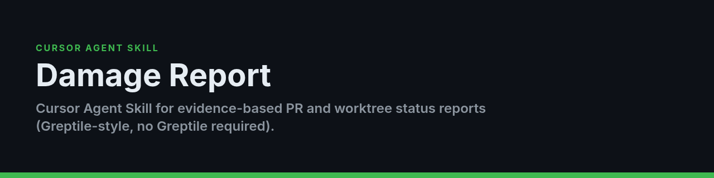

<p align="center">
  
</p>

# Damage Report

**Cursor Agent Skill for evidence-based PR and worktree status reports (Greptile-style, no Greptile required).**

[](LICENSE)


A Cursor Agent Skill that performs a Greptile-style, evidence-based review of either:

- the current working tree,
- a feature branch against its base,
- or a GitHub pull request.

It produces a persistent engineering report with findings, verification evidence, a Damage Score, Release Readiness, and a direct merge recommendation. It does **not** require Greptile.

## What it checks

- Correctness and acceptance criteria
- Security, authentication, and authorization
- Data integrity and migrations
- API and schema compatibility
- Error handling and operational recovery
- Concurrency, retries, and idempotency
- Performance and reliability
- Tests, build, types, and lint
- UI, accessibility, and responsive states
- CI, PR comments, reviews, and scope drift

## Installation

### User-wide

```bash
git clone https://github.com/Awkward8787/damage-report.git
cd damage-report
./scripts/install.sh --user
```

### One project

```bash
git clone https://github.com/Awkward8787/damage-report.git
cd damage-report
./scripts/install.sh --project /absolute/path/to/your/project
```

Manual installation is also valid: clone or copy this repository to:

```text
~/.cursor/skills/damage-report/
```

or:

```text
<project>/.cursor/skills/damage-report/
```

The directory must contain `SKILL.md` at its root.

## Usage

In Cursor Agent:

```text
/damage-report
/damage-report --quick
/damage-report --full
/damage-report 123
/damage-report https://github.com/OWNER/REPO/pull/123
/damage-report --base origin/develop
/damage-report security and API contracts
```

Reports are written locally to:

```text
.cursor/damage-reports/latest.md
.cursor/damage-reports/<timestamp>-<target>.md
```

The skill does not stage or commit those files.

## Requirements

- Cursor with Agent Skills support
- `git`
- Optional: authenticated GitHub CLI for PR enrichment

```bash
gh auth login
```

- The repository's own build and test toolchain

## Design

The skill follows the open Agent Skills `SKILL.md` format. Detailed scoring and output rules are separated into `references/` so Cursor loads them only when needed.

## Relationship to Damage Report Loop

`damage-report` is review-only. Use the companion `damage-report-loop` skill when you want Cursor to fix valid findings, rerun checks, and repeat until the branch is clear or a safety gate stops the loop.

## License

MIT

## Download

Packaged skill archives are published on the [Releases page](https://github.com/Awkward8787/damage-report/releases); the latest release carries `damage-report-skill-v0.1.0.zip`.

### Install from the release
1. Download `damage-report-skill-v0.1.0.zip` from the latest release and unzip it.
2. From the unzipped folder, install the skill:
   ```bash
   ./scripts/install.sh --user                               # user-wide (~/.cursor/skills/damage-report/)
   ./scripts/install.sh --project /absolute/path/to/project  # one project
   ```
   Or copy the folder (the one containing `SKILL.md`) to `~/.cursor/skills/damage-report/`.

### Run
In Cursor Agent:
```text
/damage-report
```
